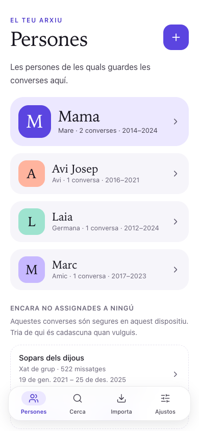
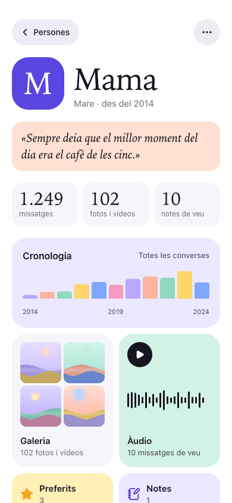
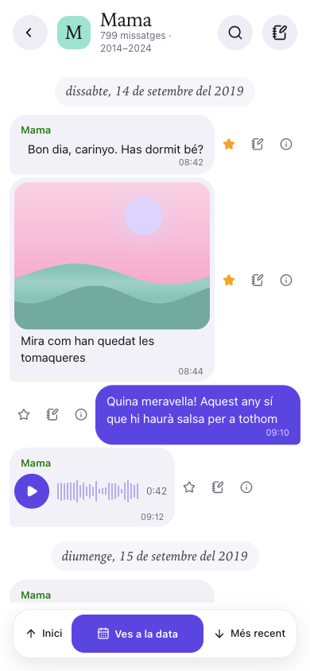
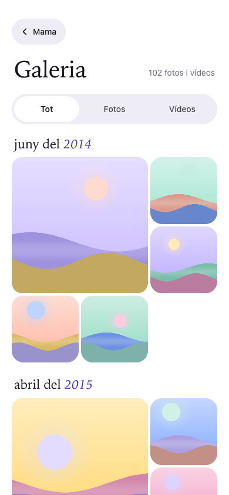
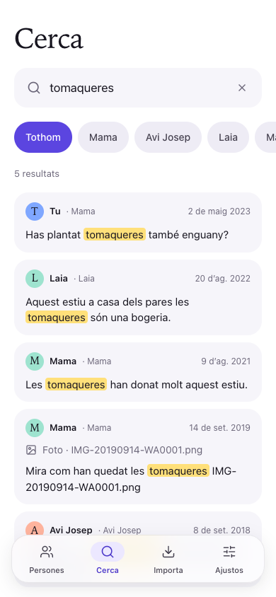
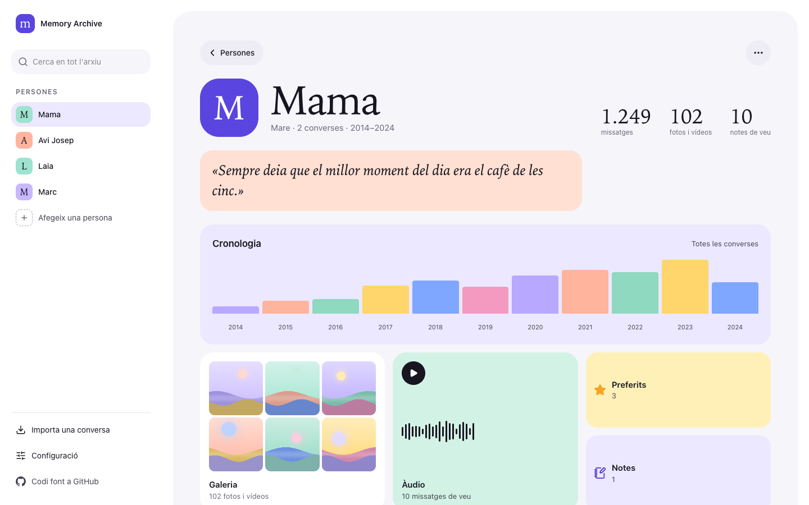
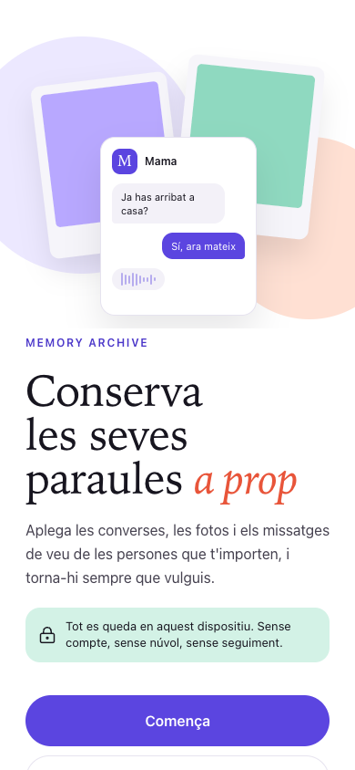
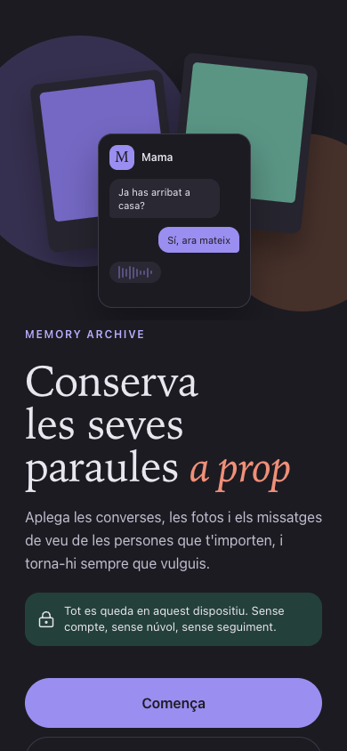
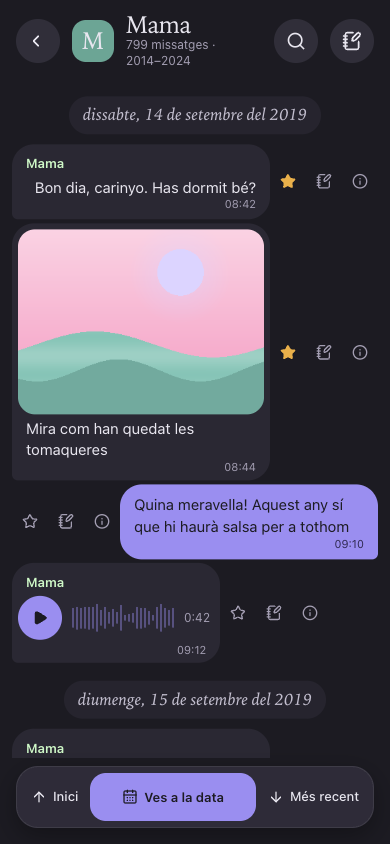
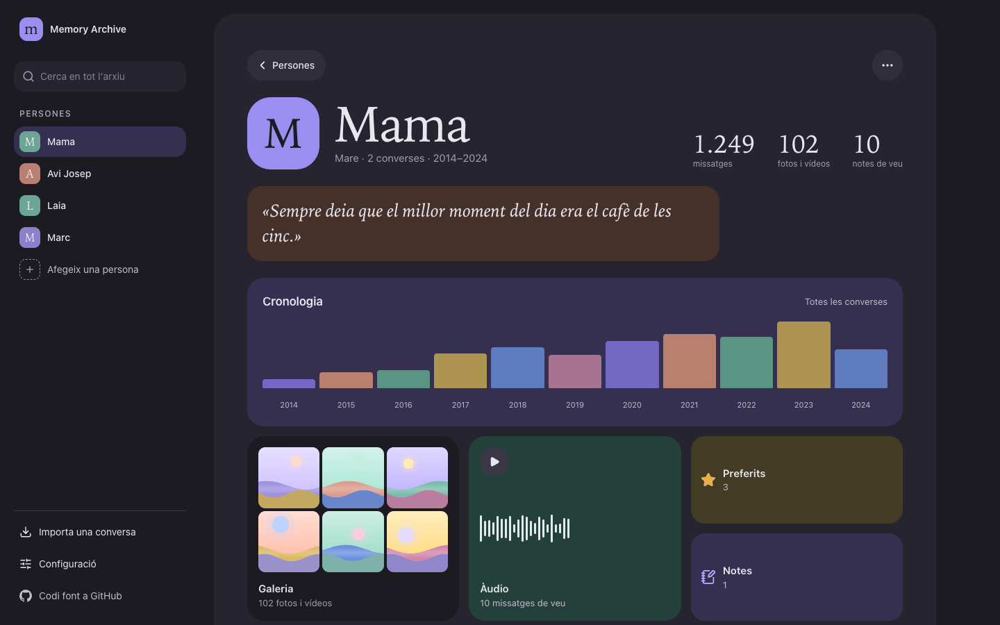

# Memory Archive

**Memory Archive** is a **privacy-first, fully offline memory archive** that brings WhatsApp conversations, photos, videos and voice messages into a **unified, portable timeline** — one profile per person you want to remember.
Everything runs **on your own device**. No server, no account, no cloud, no telemetry: your memories never leave your hands.

> **Status:** in development (v0.6). The installable offline app already imports WhatsApp ZIPs into profiles, with timeline, conversation view, gallery, audio, calendar, search and favorites, and can export a full backup ZIP and restore it into an empty library. It also keeps the original **WhatsApp export → Markdown / HTML / JSON** command-line tool (inherited from [guionardo/wa-backup](https://github.com/guionardo/wa-backup)). Sync, Google Photos import and the portable viewer are still ahead — see [🗺️ Roadmap](#️-roadmap).

---

## 📸 Screenshots

Synthetic Catalan demo data (invented people and messages); the app is local-only and works offline. Left to right: People, a person, a conversation, the photo gallery, search.

<p align="center">
  
  
  
  
  
</p>

<p align="center">
  
</p>

Light and dark follow the device setting:

<p align="center">
  
  
  
  
</p>

<p align="center">
  
</p>

Regenerate them with `pnpm build && pnpm screenshots` (see [docs/blueprint.md](docs/blueprint.md)).

---

## 🧩 Features

### Available today (CLI)

* **WhatsApp export parsing**: reads the official *Export chat* ZIP (`_chat.txt` + media), auto-detecting day/month order and 12h/24h formats (`pt-BR`, `en-US`, and more).

* **Streaming and memory-safe**: parses line by line, so huge chats with videos stay flat in memory.

* **Three synchronized outputs**: Markdown, a WhatsApp-style HTML viewer, and structured JSON, plus a `messages.csv` source of truth.

* **Media reconciliation**: photos, videos, voice notes and other audio, documents and stickers are copied next to the outputs with relative paths, or inlined into one self-contained HTML file.

* **Incremental updates**: re-running on a newer export of the same chat merges only the new messages.

* **Re-import old backups**: rebuild a backup from an old `messages.json`, `messages.html` or `messages.csv`, or re-render it.

* **XSS-safe output**: all chat content is escaped before rendering.

### In the Memory Archive app (✅ available, 🟡 partly, ⬜ coming next)

* ✅ **One profile per person**: parents, partners, friends — each with their own conversations, photos, videos, voice messages and notes.

* ✅ **Install on any device**: an installable web app (PWA) for iPhone, Android, Mac, Windows and Linux that works offline.

* ✅ **Incremental, duplicate-free imports**: import the same chat again years later and only the new messages are added.

* ⬜ **Hand-picked photos**: import from your phone gallery, a Google Photos download or a Google Takeout album, and choose exactly which photos belong to whom.

* ✅ **Timeline, gallery, audio archive and calendar** per person, with search and favorites.

* 🟡 **One-file backup and restore**: export your whole archive into a single ZIP and restore it on any other device.

* ⬜ **Manual device-to-device sync**: export a small *changes* ZIP on one device and merge it on another.

* ⬜ **Portable viewer**: a single HTML file you can send to a relative — it opens with a double-click, no install needed.

---

## 🔒 Privacy

* **Local only.** All parsing, storage and rendering happens on your device.
* **No accounts, no keys, no backend.** There is nothing to sign up for and nothing to configure.
* **No telemetry or analytics.**
* **You own the file.** Your archive can always be exported as a plain ZIP (SQLite database + original media + integrity manifest) and read without this app.

See [`docs/privacy.md`](docs/privacy.md) for details.

---

## 🚀 Installation and Usage

### Try it in the browser

The latest release is published at <https://rwxce.github.io/memory-archive/>. Everything runs
and stays on your device; nothing is uploaded.

### Requirements

* **Node.js 24** (see `.nvmrc`).
* **pnpm 11** — enable it once with `corepack enable` (or `npm i -g pnpm`).

### Run the CLI

1. **Clone the repository**

   ```bash
   git clone https://github.com/rwxce/memory-archive.git
   cd memory-archive
   pnpm install
   ```

2. **Export a chat from WhatsApp**

   Open the conversation → **⋮ Menu → More → Export chat** → *Include media* (or *Without media*). Save the ZIP somewhere on your computer.

3. **Convert it**

   ```bash
   pnpm cli "WhatsApp Chat - X.zip"
   ```

4. **Open the result**

   ```
   output/<chat-name>/
   ├── messages.csv     # source of truth, one row per message
   ├── messages.json    # structured envelope (metadata + messages)
   ├── messages.md      # human-readable Markdown log
   ├── messages.html    # WhatsApp-like viewer — double-click to open
   └── media/           # reconciled media files
   ```

### Re-import or re-render an existing backup

```bash
# Rebuild messages.csv from an older output (wa-backup or memory-archive) and re-render everything
pnpm cli import-legacy "output/<chat-name>/messages.html"     # or messages.json / messages.csv
pnpm cli import-legacy old/messages.json --out ./backup        # into ./backup/<chat-name>/

# Re-render messages.json / .md / .html from messages.csv (offline)
pnpm cli render "output/<chat-name>"
```

`messages.md` cannot be re-imported: it is a lossy rendering. The JSON format is documented
in [`docs/formats/legacy-json.md`](docs/formats/legacy-json.md).

### CLI options

| Option | Description |
| ------ | ----------- |
| `[zip]` / `--zip <path>` | Path to the WhatsApp *Export chat* ZIP. |
| `--out <dir>` | Output directory (default: `output/<chat-name>/`). |
| `--day-first` / `--month-first` | Force the date order if auto-detection guesses wrong. |
| `--me <name>` | Your author name in the chat: your messages become the outgoing (right-hand) bubbles. Default: the most active author. |
| `--inline` | Embed media as base64 into one self-contained HTML file (videos stay linked). |
| `--fetch-titles` | Opt in to fetching link titles from the web. **Off by default**: the CLI makes no network request without it. Private, loopback and link-local addresses are never contacted; titles fetched earlier are kept. |
| `--no-fetch-titles` | Accepted for compatibility; offline is already the default. |
| `--verbose` | Print the detected format and any overrides. |

---

## 🛠️ Development

| Command | What it does |
| ------- | ------------ |
| `pnpm install` | Install dependencies (only versions published ≥ 7 days ago). |
| `pnpm dev` | Run the app in development (`next dev`, http://localhost:3000). |
| `pnpm preview` | Serve the built app from `out/` on http://localhost:4173 (dependency-free `scripts/serve-out.mjs`; set `NEXT_PUBLIC_BASE_PATH` to preview a sub-path build). |
| `pnpm cli <zip>` | Run the CLI from source with `tsx`. |
| `pnpm check` | i18n parity → lint → typecheck → tests → build → smoke. Must be green before any PR. |
| `pnpm test` | Generate synthetic fixtures and run the Vitest suite (tests live next to the code as `*.test.ts(x)`). |
| `pnpm build` | Inline the viewer scripts, bundle the CLI into `dist/` (tsup, `bin`: `memory-archive`), export the app into `out/` (`next build`) and build the offline service worker `out/sw.js`. |
| `pnpm smoke` | Run the **built** CLI on the synthetic fixture ZIP, and check that every page of `out/` exists and loads nothing from another site. |
| `pnpm i18n:check` | Check that `messages/{ca,es,en}.json` have the same keys and placeholders. |
| `pnpm icons` | Regenerate the app icons from code (`scripts/generate-icons.mjs`, no image tools). |

* **Offline**: `pnpm preview` serves the production build with its service worker. After the first load the app keeps working with the network off (DevTools → Network → Offline). `pnpm dev` has no service worker.

* **UI copy** lives in `messages/{ca,es,en}.json`; ESLint rejects hard-coded text in JSX. Tone rules: [`docs/tone.md`](docs/tone.md).
* **No telemetry**: Next.js telemetry is switched off in the scripts and in `next.config.ts`.

* **Branches**: work on a feature branch → PR into `dev`. `main` only receives `release: vX.Y.Z` PRs from `dev`. See [`docs/branching-and-releases.md`](docs/branching-and-releases.md).
* **Supply chain**: exact versions, `minimumReleaseAge` of 7 days, Dependabot with a 7-day cooldown.
* **Fixtures only**: tests use synthetic chats generated by `scripts/generate-fixtures.mjs`. Never commit a real WhatsApp export.
* **Full inventory** of tooling, tests and rules: [`docs/blueprint.md`](docs/blueprint.md).

---

## 🏗️ Stack

* **App**: Next.js 16 static export (no server) as an installable, offline PWA (Serwist service worker, web manifest, Android share target), React 19, Tailwind CSS 4 + shadcn/ui, next-intl (`ca` / `es` / `en`), system fonts only. Coming in Phase 2: SQLite WASM stored in the browser's private file system (OPFS).
* **CLI**: TypeScript 6 (strict), Node 24 (ESM), commander, fflate (inflate), date-fns, tsup, tsx.
* **Tooling**: ESLint 10 (layer boundaries, no cycles, no hard-coded UI text), Vitest 5 (+ happy-dom for components), pnpm 11.

---

## 🗂️ Architecture

```
app/[locale]/             # Next.js pages (static export): welcome, settings
components/  hooks/       # UI components (shadcn/ui in components/ui) and React hooks
sw/                       # service worker: offline precache, share target
i18n/  messages/          # next-intl routing + UI copy in ca / es / en
lib/                      # platform-neutral core (Node and browser; no Node APIs)
  domain/                 # pure types and constants
  importers/whatsapp/     # ZIP reader (central directory + ZIP64, fflate inflate),
                          # _chat.txt line splitting, timestamp detection,
                          # message state machine, media matching
  importers/legacy/       # readers for old messages.json / .html / .csv outputs
  exporters/legacy/       # CSV / JSON / Markdown / HTML renderers (strings in, strings out)
    js/                   # browser scripts shared with the generated HTML
cli/                      # Node CLI: commander, file I/O, media copy, link titles
scripts/                  # fixture generator and repo tooling
docs/                     # blueprint, product, PRD, roadmap, policies
```

Tests sit next to the code (`*.test.ts`). `lib/` must run unchanged inside a Web
Worker: ESLint rejects Node imports and globals there, and `lib/platform.test.ts`
runs the importer from a `Blob` with Node-only globals removed.

Target layout for the app (see [`docs/roadmap.md`](docs/roadmap.md)):

```
app/[locale]/             # Next.js pages (static export, PWA)
components/  hooks/
lib/
  domain/                 # canonical model: profiles, conversations, messages, media
  db/                     # SQLite WASM worker + versioned migrations
  storage/                # content-addressed blobs (sha256) in OPFS
  importers/<source>/     # whatsapp, google-takeout, loose files
  exporters/              # backup ZIP, change packs, portable viewer
  usecases/               # import, backup, restore, sync, export
viewer/                   # single-file offline HTML viewer
cli/                      # same use cases from the terminal
```

### Main flows

1. **Import** — WhatsApp ZIP → parse in a Web Worker → fingerprint and deduplicate → store messages in SQLite and media by hash → import summary.
2. **Backup** — archive → `memory-archive-YYYY-MM-DD.zip` (database snapshot + media + `manifest.json` with hashes).
3. **Restore / sync** — open a backup or *changes* ZIP on another device → validate → merge without duplicates.

---

## 🗺️ Roadmap

| Phase | Status | Scope |
| ----- | ------ | ----- |
| 0 | ✅ | Tooling: pnpm, 7-day release age, CI, agent rules (rulesync), docs |
| 1 | ✅ | Reusable core for Node and browser, bug fixes, re-import of old HTML/JSON/CSV outputs |
| 2 | ✅ | PWA skeleton, local SQLite database, backup/restore proof of concept |
| 3 | 🟡 | Profiles and conversations |
| 4 | 🟡 | Incremental WhatsApp import and import history |
| 5 | 🟡 | Timeline, conversation view, gallery, audio, calendar, search |
| 6 | 🟡 | Full backup and restore |
| 7 | ⬜ | Manual device-to-device sync with ZIP files |
| 8 | ⬜ | Google Photos (download / Takeout) and loose files |
| 9 | ⬜ | Portable viewer exports and hardening |

✅ done · 🟡 mostly done, small follow-ups or on-device checks pending · ⬜ not started. Details in [`docs/roadmap.md`](docs/roadmap.md).

---

## 🧾 License

This project is licensed under the **MIT License**. See the [LICENSE](LICENSE) file for details.
It started as a fork of [guionardo/wa-backup](https://github.com/guionardo/wa-backup) by Guionardo Furlan, also MIT.
